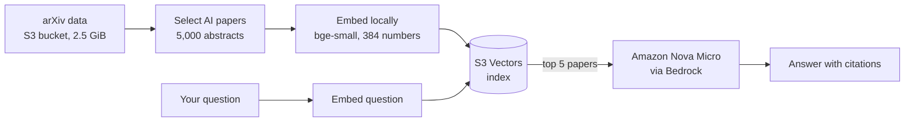

# AI Research Assistant (RAG on AWS)

Ask a question about AI research in plain English. The assistant finds the most relevant arXiv papers and writes a short answer that **cites them**.

Built as a learning project in AI engineering: retrieval-augmented generation (RAG), cloud infrastructure as code, automated checks, and a clean teardown so nothing keeps billing.

## How it works



1. **Store**: the raw arXiv metadata (11 parquet files, 2.5 GiB) lives in an Amazon S3 bucket.
2. **Embed**: 5,000 AI papers (categories cs.AI, cs.CL, cs.LG, stat.ML) are turned into 384-number vectors with the free `BAAI/bge-small-en-v1.5` model, run on the local machine. One chunk = one paper's title plus abstract.
3. **Search**: the vectors are stored in an Amazon S3 Vectors index. A question is embedded the same way and the closest papers are returned (cosine distance).
4. **Answer**: the top 5 papers are given to Amazon Nova Micro (Bedrock), which is told to answer only from those sources and cite them as [1], [2], and so on.

## Project layout

| Path | What it is |
|---|---|
| `infra/` | Terraform: data bucket, vector bucket, vector index |
| `rag/ingest.py` | Select papers, embed them, store the vectors |
| `rag/search.py` | Find the closest papers for a question |
| `rag/answer.py` | Write a cited answer with Bedrock |
| `rag/evaluate.py` | Score the search on 20 test questions |
| `eval/questions.json` | The 20 test questions and their topic keywords |
| `tests/` | Unit tests for the scoring logic |
| `.github/workflows/ci.yml` | CI: lint, tests, Terraform format and validate |

## Run it

Requirements: an AWS account, AWS CLI configured, Terraform, Python 3.13.

```bash
pip install -r requirements.txt

# 1. Build the infrastructure
cd infra && terraform init && terraform apply && cd ..

# 2. Index 5,000 AI papers
python rag/ingest.py --limit 5000

# 3. Ask a question
python rag/answer.py "How can language models avoid hallucinating?"

# 4. Score the search
python rag/evaluate.py
```

## Results

Evaluation on 20 test questions, top 5 papers each. A paper counts as relevant if its title or abstract contains one of the question's topic keywords.

| Metric | Score |
|---|---|
| precision@5 (average share of relevant papers) | **0.83** |
| hit@5 (questions with at least one relevant paper) | **1.00** |

## Honest limits

- **The score is a rough proxy.** It counts keyword matches. It does not judge whether a paper truly answers the question.
- **Everyday wording is weaker.** "How can language models avoid making things up?" and "How can AI models be tricked into harmful behavior?" each scored only 1 of 5 relevant, while technical wording scored 5 of 5. The small embedding model matches technical terms better than casual phrasing.
- **The sample is biased.** The 5,000 papers are the first AI papers in the data, so they skew towards recent ones.
- **Answers can sound more general than their sources.** The prompt asks for citations only, but it does not check every claim.

Next improvements: a stronger embedding model (this needs a new index and a re-ingest), a more diverse paper sample, and an answer check against the cited abstracts.

## Cost

- Nova Micro: about $0.035 per million input tokens and $0.14 per million output tokens, so roughly 0.01 cent per question (estimate from published prices).
- S3 storage for 2.5 GiB: cents per month. S3 Vectors has no idle cost; it is pay-per-use.
- Actual total bill for this project: **[fill in from the AWS Billing page after teardown]**

## Safety and clean-up

- No keys or secrets are stored in the repo (see `.gitignore`).
- CI needs no AWS credentials: it only lints, runs unit tests, and validates the Terraform files.
- Remove everything when done:

```bash
cd infra && terraform destroy
```

`force_destroy` is set, so the buckets are deleted even though they contain data.

## Demo

**Question:** How can language models avoid hallucinating?

> Language models can avoid hallucinating by employing techniques like activation steering [1], which guides parallel token predictions through internal representations, and Step-level Self-Consistency Group Relative Policy Optimization (SSC-GRPO) [3], which uses self-consistency scores across multiple rollouts to detect and mitigate context-sensitive factual hallucinations. Additionally, uncertainty estimators can help identify unreliable generations, though their effectiveness varies [4]. However, the sources do not provide a comprehensive, singular solution, indicating that a combination of methods may be necessary [1][3][4].

Top sources: [1] TRACESTEER: Trace Driven Activation Steering for Hallucination Mitigation in Diffusion Language Models (arXiv 2610.18173) · [3] Reasoning Error from Known Fact: Step-Level Self-Consistency GRPO for LLMs (arXiv 2607.18915) · [4] How Do Uncertainty Estimators Align with Hallucination Occurrence in LLMs? (arXiv 2605.27016)

**Question:** What are the main ways to jailbreak a language model?

> The main ways to jailbreak a language model, as inferred from the provided sources, include adversarial prompts that bypass safety alignment and induce harmful responses [1][3], and techniques that exploit vulnerabilities in dynamic inference [3]. Additionally, PRISM framework highlights interventions to mitigate unsafe tool calls [5]. However, specific methods are not detailed in the provided sources.

Top sources: [1] Did the LLM Answer the Question? A Semantic Reconstruction Game for Jailbreak Evaluation (arXiv 2610.19306) · [3] Exploring Jailbreak Vulnerability Across Depth-Based Dynamic Inference in Large Language Models (arXiv 2610.15207)

**What these two runs show:** the answers stay grounded in the retrieved papers, cite them, and say so when the sources are not enough. The weak spots are also visible. The first answer leans on a paper about diffusion language models, and the second one cites a paper about defending tool calls, not about jailbreaking.
